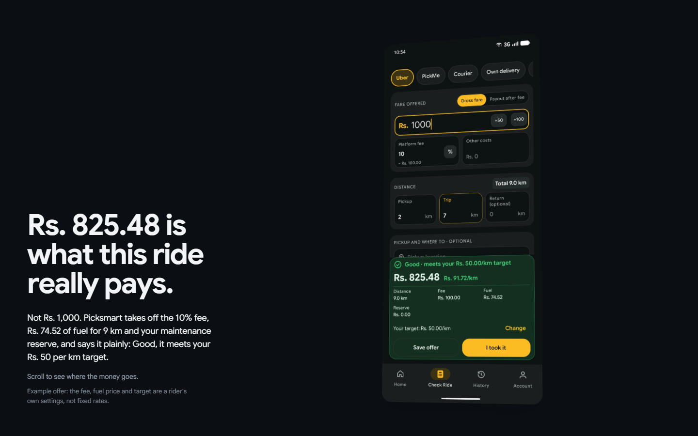
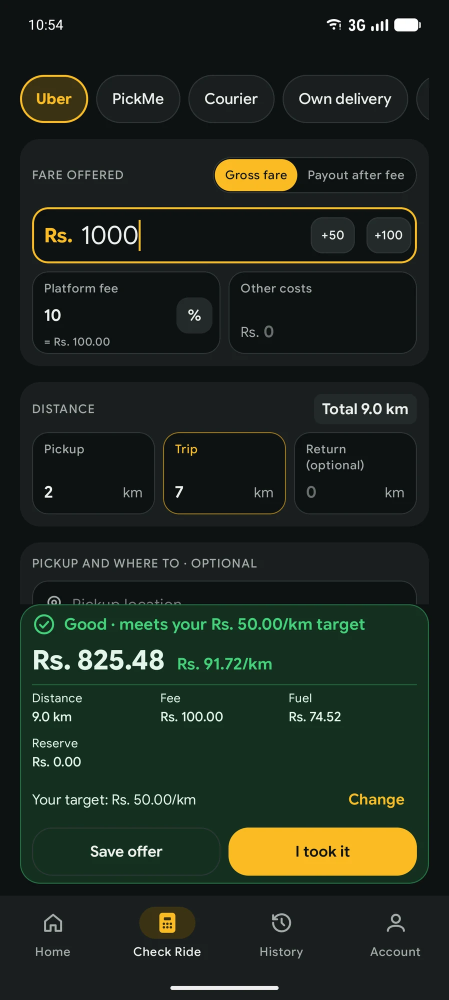
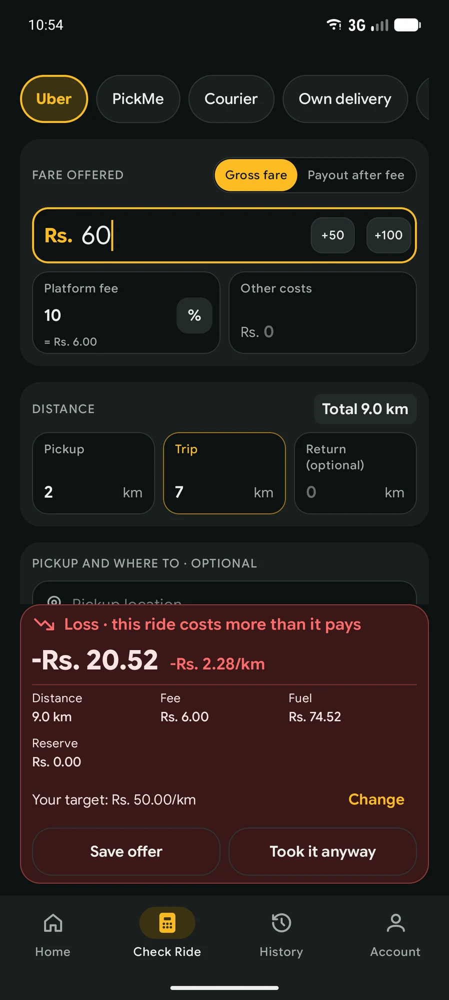
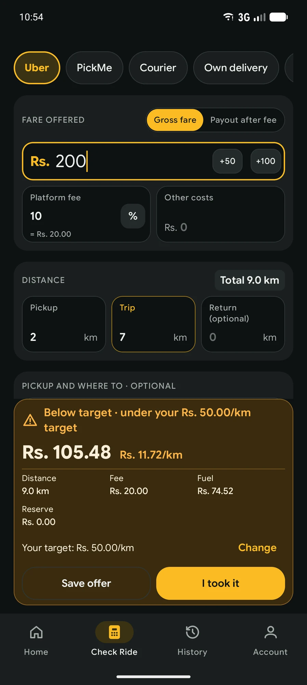
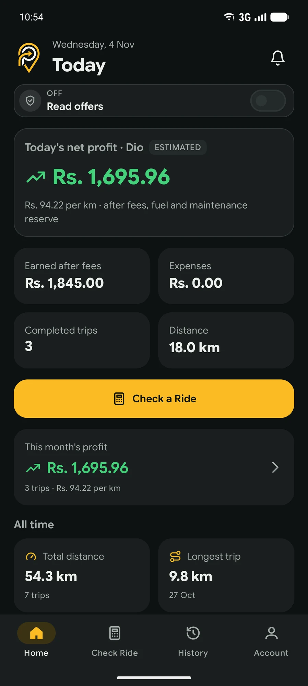
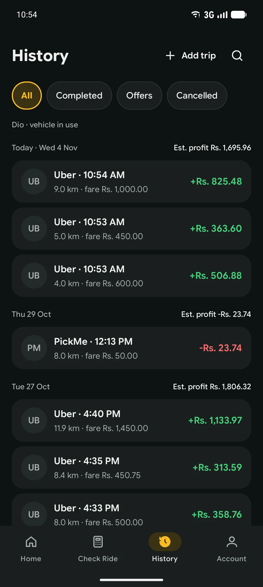
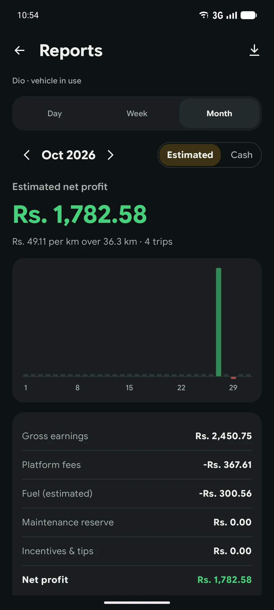
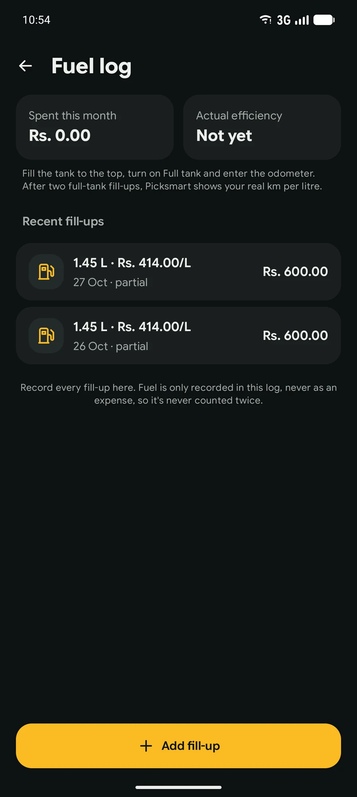

<p align="center">
  
  &nbsp;&nbsp;
  
</p>

<p align="center">
  <strong>Know your real profit before you ride.</strong><br />
  The landing page for the Picksmart app: for Uber, PickMe and delivery riders in Sri Lanka.
</p>

<p align="center">
  
</p>

---

## About

Picksmart shows Uber, PickMe and delivery riders in Sri Lanka what a ride will **really** earn, after the platform fee, fuel and wear, **before** they accept it.

This repository is the marketing website for the app. It tells the story of one rider and one offer while scrolling, and a 3D phone (React Three Fiber) shows the real app screens beside the text.

<p align="center">
  
</p>

### Example: where a Rs. 1,000 fare goes

| | |
|---|---:|
| Fare offered | Rs. 1,000.00 |
| Platform fee, 10% | − Rs. 100.00 |
| Fuel for 9 km | − Rs. 74.52 |
| Maintenance reserve | − Rs. 0.00 |
| **What you keep** | **Rs. 825.48** (Rs. 91.72 per km · Good) |

The fee, fuel price and per-km target are the rider's own settings, not fixed rates.

## App features

| Check a Ride | Loss | Below target |
|:---:|:---:|:---:|
|  |  |  |
| Three numbers in, one honest answer out. | It tells you when to say no. | Set the rupees per km you're happy with. |

| Home | History | Reports | Fuel log |
|:---:|:---:|:---:|:---:|
|  |  |  |  |
| Your day, after costs, on one screen. | Every ride you took, kept. | Your week and month, line by line. | Your real km per litre, from real fill-ups. |

## Whatever you ride

Motorbike, three-wheeler, car, or deliveries for your own shop. Each vehicle keeps its own fuel type, km per litre and maintenance reserve.

<p align="center">
  
</p>

## Plans

No plan ever limits how many rides you can check or record. These plans are planned for launch and may change.

| Free | Signed in | Premium |
|---|---|---|
| No account | Free account | Coming later |
| Unlimited ride checks and trips | Everything in Free | Everything when signed in |
| This week's reports | Reports for your whole history | Unlimited vehicles |
| 1 vehicle | Cloud backup and restore on a new phone | Fill a check from a screenshot |
| | Export to CSV | Shift reminder and quick tile |
| | Up to 3 vehicles | Monthly and tax summaries |

## Tech stack

- [Vite](https://vite.dev/): dev server and build
- [three.js](https://threejs.org/) + [React Three Fiber](https://r3f.docs.pmnd.rs/): the 3D phone (loaded lazily, only when the 3D sequence runs)
- [GSAP](https://gsap.com/): scroll-driven story and animation
- Plain HTML and CSS for the page itself, so it still works on small screens and with reduced motion

## Getting started

You need [Node.js](https://nodejs.org/) 20.19 or newer (needed by Vite).

```bash
npm install
```

```bash
npm run dev
```

Then open http://127.0.0.1:5173.

To build the site for hosting (output goes to `dist/`):

```bash
npm run build
```

```bash
npm run preview
```

The build uses `base: "./"`, so the `dist/` folder works from any folder or sub-path (GitHub Pages, Netlify and so on).

## Project structure

```
├── index.html              # Page markup
├── styles.css              # All styles
├── data/
│   ├── site.js             # Every piece of text and image on the page lives here
│   └── scroll.js           # The phone's path down the page
├── src/
│   ├── main.js             # Entry point: fills the page from data/site.js
│   ├── story.js            # One GSAP scroll timeline for the whole page
│   ├── lens.js             # The lens: shows the maths under the phone screen
│   ├── type.js             # Headings that react to the pointer
│   └── scene/              # The 3D phone (React Three Fiber)
├── public/
│   ├── assets/app/         # Real app screenshots
│   ├── assets/brand/       # Logo and wordmark
│   ├── assets/story/       # Story illustrations
│   └── privacy-policy.html
└── docs/screenshots/       # Images used in this README
```

To change any text, price or image on the page, edit [`data/site.js`](data/site.js).

## Contact

Early access and questions: [bimanthaperera55@gmail.com](mailto:bimanthaperera55@gmail.com)

The app is coming soon to Google Play.
